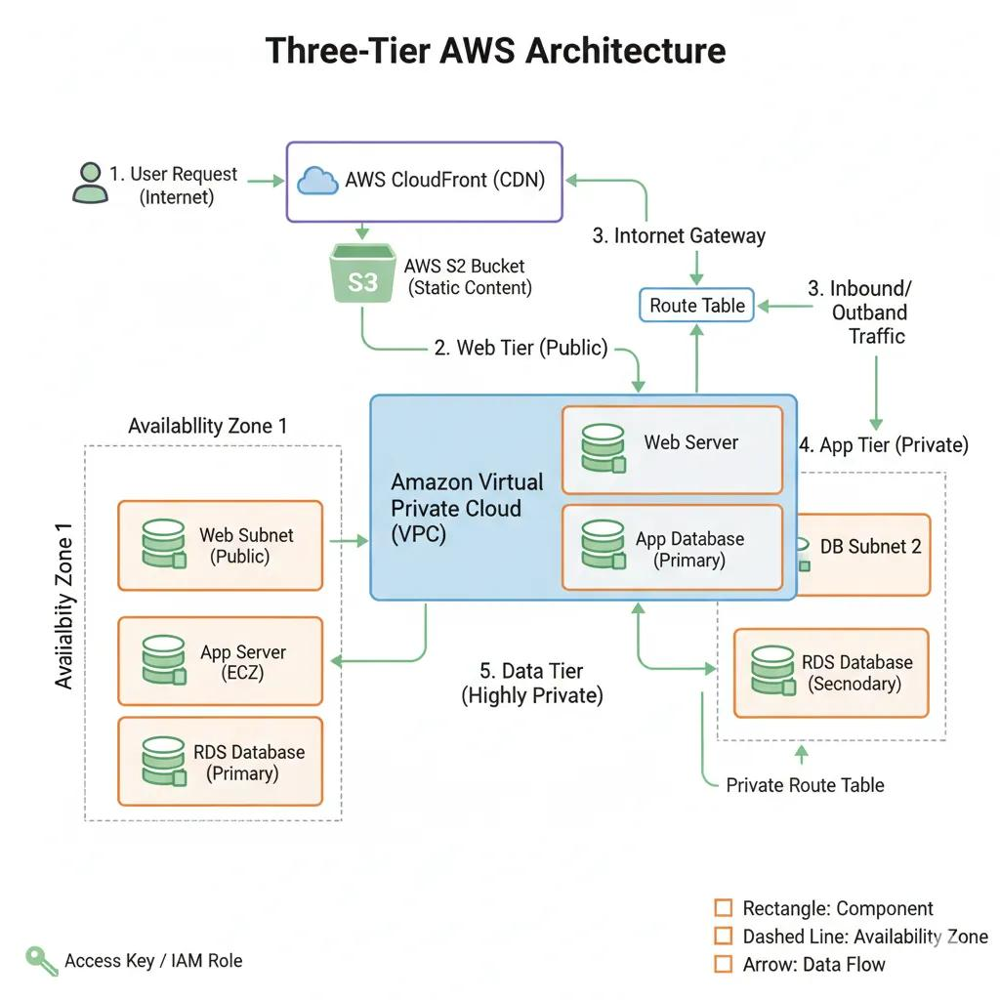
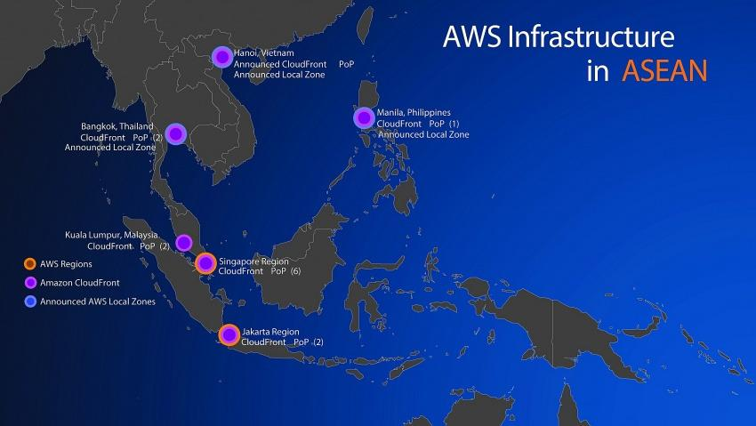

# XBrain TechTalk Slides

**AWS Hanoi Local Zone for Vietnam workloads: architecture, data residency and trade-offs**

An interactive 16:9 technical-keynote deck built with React, TypeScript, GSAP and official AWS Architecture Icons. The projected deck contains 14 slides / 25 minutes; appendices stay outside the timed flow.


## Run the deck

```bash
npm install
npm run dev
```

Production checks:

```bash
npm run lint
npm run build
npm run preview
```

Open `http://localhost:5173/#slide-1`. Each slide has a stable `#slide-N` URL.

## Presenter controls

- `←` / `→`, `Page Up` / `Page Down`, `Space`: navigate
- `Home` / `End`: first / last slide
- `N`: toggle bilingual speaker notes and sources
- `O`: open the 14-slide overview
- `E`: open the local responsive layout tuner
- `F`: fullscreen
- `Esc`: close notes or overview
- Toolbar print button: export the 14 slides with 16:9 print CSS
- Swipe left/right: touch navigation

The deck honors `prefers-reduced-motion`. For the live talk, use browser fullscreen and keep the prerecorded demo fallback available.

## Responsive layout and local tuning

On projector and laptop viewports, the deck preserves its 16:9 presentation canvas. On narrow or portrait viewports it automatically switches to a vertical reading mode: layouts reflow, diagrams/cards stack, the decision matrix becomes labeled cards, and typography keeps a readable size instead of shrinking the whole canvas. The mobile mode uses `100dvh` and page scrolling to avoid browser-toolbar clipping.

Press `E` or use the sliders icon to open the local layout tuner:

1. Click or drag a major slide content block.
2. Fine-tune its X offset, Y offset and scale with the sliders.
3. Resize the browser to switch automatically between `compact`, `laptop` and `wide` profiles.
4. Use **Reset block** or **Reset slide** to safely undo local adjustments.
5. Use **Copy JSON** to export the versioned configuration for sharing or later integration into source.

The same panel also supports **Insert image on this slide**. Uploaded images are stored locally in IndexedDB, appear only on the selected slide, and can be dragged/resized on laptop or wide profiles. In compact reading mode they join the document flow at full width. Use the panel's image list to edit alt text or delete an image. Browser-local images are intentionally excluded from print/export until they are promoted into repository assets and referenced in source.

Adjustments are stored in browser `localStorage` under `xbrain-slide-layout:v1`. They are intentionally local and do not rewrite React/CSS source. Footer evidence, slide numbering, full-bleed backgrounds and decorative layers are locked to protect the publication layout. Print output excludes the editor UI and keeps the canonical source layout; integrate exported JSON into source before printing if a local adjustment should become permanent.

## Content and design sources

- [`CODEX_SLIDE_BRIEF.md`](CODEX_SLIDE_BRIEF.md): original content and QA brief
- [`DESIGN_DECISIONS.md`](DESIGN_DECISIONS.md): selected technical-keynote direction and rejected alternatives
- [`CONTENT_VERIFICATION.md`](CONTENT_VERIFICATION.md): claim-to-source ledger and pre-talk recheck list
- [`IMAGES.md`](IMAGES.md): missing/replacement assets, exact filenames and short descriptions
- [`APPENDIX.md`](APPENDIX.md): appendix backlog, intentionally outside the 14-slide flow

The implemented direction is **Editorial Cloud Infrastructure × Operational Dashboard × XBrain Orange**: near-black navy, warm paper interludes, restrained orange/cyan semantics, real topology boundaries, and purposeful motion. The older HUD-heavy design system remains reference material only.

## Project structure

```text
src/
├── app/                 # Application entry composition
├── assets/              # Typed imports for official AWS icons
├── components/
│   ├── deck/            # Navigation, stage, overview, notes and print
│   └── slides/          # Shared slide primitives and frame
├── content/             # 14-slide manifest, timing, notes and sources
├── hooks/               # Hash, keyboard and touch navigation
├── slides/              # All 14 slide compositions
├── styles/              # Design tokens, layouts, motion and print CSS
└── types/               # Shared deck contracts
```

Repo-local Codex skills are in `.codex/skills/`. Official AWS icons are read from `icon-package-aws/`.

## Slide order — 25 minutes

| # | Slide | Time |
|---:|---|---:|
| 1 | AWS Hanoi Local Zone | 0:30 |
| 2 | Vietnam Workload Dilemma | 1:30 |
| 3 | Local Zone Is Not a Region | 1:30 |
| 4 | Opt In. Deploy. Verify. | 1:30 |
| 5 | Where Does Data Actually Live? | 2:00 |
| 6 | Residency Is Not Compliance | 2:00 |
| 7 | Service Reality Check | 1:30 |
| 8 | Three Architectural Gotchas | 1:30 |
| 9 | Moving Compute Doesn't Move Dependencies | 2:00 |
| 10 | Let's Measure It | 3:00 |
| 11 | Migration Is More Than Lift-and-Shift | 2:00 |
| 12 | One Local Zone. One Local Fault Domain. | 2:00 |
| 13 | Is Hanoi the Right Choice? | 3:00 |
| 14 | Closer Isn't Automatically Better | 1:00 |

## Presenter-owned inputs still required

The deck deliberately does not invent measurements, legal conclusions, or image provenance. Before the talk:

1. Replace/approve the two Local Zone ↔ parent Region architecture assets described in `IMAGES.md`.
2. Run the benchmark and supply the timestamp, environment, sample size, p50/p95 and error rate; otherwise keep `BENCHMARK_PENDING` and use the prerecorded fallback.
3. Verify the usage rights/source for `hanoi.png` or replace it with `hanoi-night-skyline-licensed.jpg`.
4. Obtain qualified legal review for slide 6.
5. Recheck the Hanoi service matrix, quotas, instance sizes and AWS documentation in the target account close to the talk date.
6. Add the official XBrain/team logo asset if the text-only brand treatment is not sufficient.

The original `3-tier.png` and `dilemma.png` remain reference inputs only; they are not used as factual slide art because their accuracy/provenance is not strong enough for publication.

## Demo: 3-tier migration experiment

Plan for a 7–10 minute optional live segment: begin with the app in Singapore, move the app tier to Hanoi, compare the measured request path, then evaluate a local database or architecture change. Provision infrastructure before presenting. Do not build the environment from scratch on stage, and do not publish results without the recorded test conditions.





